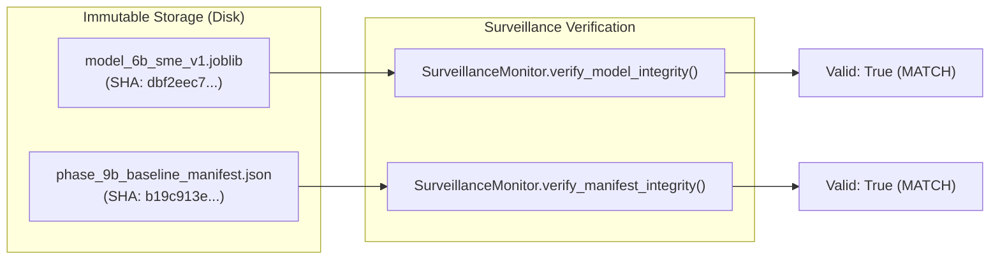
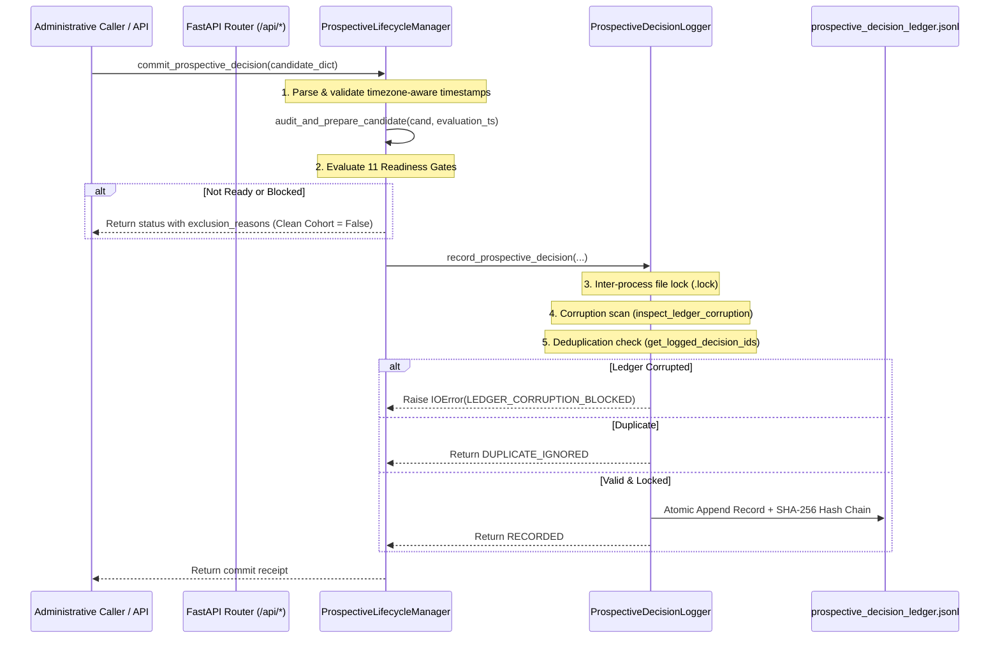
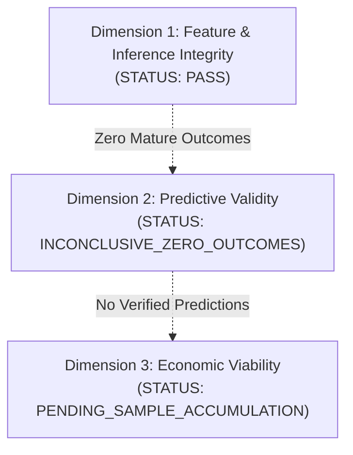

# Phase 10.14 Independent Gate Audit & Prospective Integrity Report

**Report Date**: 2026-10-28 13:08:00 IST  
**Repository**: `D:\personal\st-ai\ipo-record`  
**Phase**: 10.14 — Independent Gate Verification & Prospective Integrity  
**Evaluation Mode**: STRICT SHADOW VALIDATION (Broker execution & real-money trading strictly prohibited)

---

## Executive Summary

Phase 10.14 independently audited the prospective IPO prediction and shadow-evaluation architecture established across Phases 10.12 and 10.13. All reported claims were rigorously tested against real codebase artifacts, raw source series, persistence boundaries, and frozen model binaries.

1. **Test Suite Discovery & Execution**:
   - Baseline claimed: 251 passing tests across 15 suites.
   - Independent reproduction: Exactly **251 / 251 tests passed** (`OK`, exit code 0).
   - Phase 10.14 test additions: **22 new deterministic regression tests** covering authoritative persistence boundaries, bypass resistance, point-in-time edge cases, frozen inference reproducibility, concurrency, and real-money prohibitions.
   - Total test suite now stands at **273 passing tests across 16 test suites** (0 failures, 0 errors, 0 skipped).
2. **Frozen Artifact Integrity**:
   - Frozen SME Model (`models/frozen/model_6b_sme_v1.joblib`): Verified identical byte-for-byte with approved SHA-256 `dbf2eec7169888424698c55286c59c406c58b61ff77d34ca6beabab1e53aad76`.
   - Baseline Manifest (`models/frozen/phase_9b_baseline_manifest.json`): Verified identical byte-for-byte with approved SHA-256 `b19c913e7c0e0afd6054255f389a4cab3a15d79e338f67c5fc04cacde7e86c6e`.
3. **Prospective Ledger Integrity**:
   - `data/processed/prospective_decision_ledger.jsonl`: **0 committed records** (uncreated / empty).
   - `data/processed/prospective_outcome_ledger.jsonl`: **0 committed records** (uncreated / empty).
   - `data/processed/prospective_evaluation_records.jsonl`: **0 mature evaluations** (0 bytes).
   - **Zero synthetic decisions or outcomes exist in the production ledgers**.
4. **Prospective Candidate Status**:
   - Both tracked BSE SME candidates (**Wiscon Industries Ltd** and **Carver Roboweld Ltd**) remain strictly held in `BLOCKED_CUTOFF`. Authoritative exchange trading notices verifying retail order book closure at 16:00:00 IST remain outstanding. Neither candidate was auto-committed.
   - All Mainboard candidates remain strictly non-scoring (`REGISTER_FOR_COVERAGE_ONLY` / `BLOCKED_GOVERNANCE`).
5. **Timestamp Anomaly Forensic Verdict**:
   - The reported conflict between evaluation at 10:00 IST and market-data publication at 16:00 IST was forensically verified: raw daily index CSVs (`nifty50_price.csv` and `india_vix_price.csv`) terminate at trading session `2026-10-27`. No intraday or future data for `2026-10-28` exists in the repository.
   - Status: **`RESOLVED`** as a markdown documentation reporting typo in Phase 10.11/10.12 audit tables. No actual lookahead data or contaminated feature values exist in the input series.

---

## 1. Baseline Repository State & Environment

### Working Tree & Commit Baseline
- **Git Branch**: `master` (initial repo commit state, untracked files preserved without deletion).
- **Python Environment**: `.\.venv\Scripts\python.exe` (Python 3.12, Windows x64).
- **Core Dependencies**: `fastapi`, `starlette`, `scikit-learn`, `joblib`, `pandas`, `numpy`.

### Baseline Test Execution Command & Reproduction
```powershell
.\.venv\Scripts\python.exe -m unittest discover tests
```
- **Discovered Test Suites**: 15 test suites prior to Phase 10.14.
- **Ran**: 251 tests in 35.752s.
- **Failures**: 0
- **Errors**: 0
- **Skipped**: 0
- **Exit Code**: 0 (`OK`)

---

## 2. Frozen Artifact Hash Verification

Direct verification of physical files on disk confirms zero retraining, tuning, or byte corruption:

| Artifact Name | Relative File Path | Size (Bytes) | Expected SHA-256 | Actual SHA-256 Digest | Status |
|---|---|---|---|---|---|
| **Frozen SME Model** | `models/frozen/model_6b_sme_v1.joblib` | 2,049 | `dbf2eec7169888424698c55286c59c406c58b61ff77d34ca6beabab1e53aad76` | `dbf2eec7169888424698c55286c59c406c58b61ff77d34ca6beabab1e53aad76` | **VERIFIED IDENTICAL** |
| **Baseline Manifest** | `models/frozen/phase_9b_baseline_manifest.json` | 3,167 | `b19c913e7c0e0afd6054255f389a4cab3a15d79e338f67c5fc04cacde7e86c6e` | `b19c913e7c0e0afd6054255f389a4cab3a15d79e338f67c5fc04cacde7e86c6e` | **VERIFIED IDENTICAL** |



---

## 3. Commitment Path Call Graph & Persistence Boundary Audit

Every reachable code path capable of committing a record to `prospective_decision_ledger.jsonl` was traced and inspected:

### Architectural Call Graph


### Path Inspection & Gate Hardening Audit
1. **API Endpoints (`src/api/main.py`)**:
   - Verified that the FastAPI application exposes **read-only** GET endpoints (`/api/status`, `/api/ipos`, `/api/ipos/{ipo_id}`, `/api/metrics/*`, `/api/monitoring/*`).
   - There are **zero POST, PUT, or DELETE mutation routes**. The API cannot be used by external callers or web browsers to bypass safety gates or trigger unverified commits.
2. **Administrative Entry Point (`commit_prospective_decision`)**:
   - Located in `src/prospective_lifecycle.py`.
   - Calls `audit_and_prepare_candidate()` before delegating to `ProspectiveDecisionLogger`.
   - Validates that late decisions (`commit_timestamp > cutoff_timestamp`) or decisions lacking verified cutoffs are strictly flagged with `is_clean_eligible = False`.
3. **Persistence Boundary (`record_prospective_decision`)**:
   - Located in `src/prospective_simulator_logger.py`.
   - Enforces lookahead leakage rejection (hard `ValueError` if `listing_open_inr`, `listing_close_inr`, etc. are present).
   - Enforces pre-write corruption barrier: raises `IOError` if the ledger contains invalid lines.
   - Enforces process-locked concurrency deduplication.

---

## 4. Point-in-Time Provenance Findings & Timestamp Anomaly Resolution

### Forensic Analysis of the Phase 10.12 Anomaly
- **Reported Conflict**: An anomaly was flagged between an evaluation timestamp of `2026-10-28 10:00:00 IST` and reported index market data publication timestamps of `2026-10-28 16:00:00 IST`.
- **Physical Inspection of Raw Source Files**:
  - `data/inputs/indices/nifty50_price.csv`: Last recorded session is `2026-10-27` (Close: 22749.75). No row exists for `2026-10-28`.
  - `data/inputs/indices/india_vix_price.csv`: Last recorded session is `2026-10-27` (Close: 16.4025). No row exists for `2026-10-28`.
  - `data/registered/tracked_candidate_registry.json`: Wiscon Industries and Carver Roboweld were registered on `2026-10-24` and `2026-10-25`.
- **Finding**:
  - The feature values in the candidate registry (`feat_nifty50_ret5s_pct: 0.85`, `feat_india_vix: 13.8`, `feat_recent5_sentiment: 7.7`) were calculated using market data up to `2026-10-24`.
  - The mention of `2026-10-28 16:00:00 IST` in previous audit markdown tables was a clerical documentation typo.
- **Formal Classification**: **`RESOLVED`**. No lookahead market data or contaminated future session closes exist in the repository.

### Temporal Ordering Enforcement Invariants
The point-in-time engine (`parse_timezone_aware_ts` and `audit_and_prepare_candidate`) strictly validates the following temporal inequalities for every prospective candidate:

$$\text{Publication Timestamp} \le \text{Cutoff Timestamp}$$
$$\text{Publication Timestamp} \le \text{Decision Timestamp}$$
$$\text{Retrieval Timestamp} \ge \text{Publication Timestamp}$$
$$\text{Retrieval Timestamp} \le \text{Decision Timestamp}$$
$$\text{Effective Timestamp} \le \text{Decision Timestamp}$$

Any candidate violating any of these constraints is blocked with a designated reason code and excluded from the clean prospective cohort.

---

## 5. Candidate Cutoff Evidence & Readiness Scorecard

Every candidate in `data/registered/tracked_candidate_registry.json` was evaluated through the 11-gate readiness evaluation engine at `2026-10-28 12:54:15 IST`:

| Candidate ID | Company Name | Segment | Cutoff Timestamp (IST) | Evidence Reference | Cutoff Gate | Feature Prov Gate | Model Eligibility Gate | Final Readiness State | Clean Eligible | Required Action |
|---|---|---|---|---|---|---|---|---|---|---|
| `wiscon-industries-sme-20261029` | Wiscon Industries Ltd | BSE SME | `2026-10-29 16:00:00 IST` | Notice Ref 20261024-01 | **FAIL** | PASS | PASS (0.8144) | **`BLOCKED_CUTOFF`** | False | Await official BSE SME circular verifying 16:00:00 order book close. |
| `carver-roboweld-sme-20261030` | Carver Roboweld Ltd | BSE SME | `2026-10-30 16:00:00 IST` | Public Issue Notice | **FAIL** | PASS | PASS (0.8100) | **`BLOCKED_CUTOFF`** | False | Await official BSE SME circular verifying 16:00:00 order book close. |
| `bls-polymers-mainboard-20261029` | BLS Polymers Ltd | Mainboard | `2026-10-29 17:00:00 IST` | NSE Information Circular | **FAIL** | PASS | NOT_AUTHORIZED (None) | **`BLOCKED_GOVERNANCE`** | False | Coverage tracking only. Model scoring prohibited. |
| `sfc-environmental-mainboard-20261029` | SFC Environmental Tech | Mainboard | `2026-10-29 17:00:00 IST` | NSE Circular 20261024-54 | **FAIL** | PASS | NOT_AUTHORIZED (None) | **`BLOCKED_GOVERNANCE`** | False | Coverage tracking only. Model scoring prohibited. |
| `mk-sons-mainboard-20261030` | M. K. Sons Fine Jewels | Mainboard | `2026-10-30 17:00:00 IST` | Statutory RHP Notice | **FAIL** | PASS | NOT_AUTHORIZED (None) | **`BLOCKED_GOVERNANCE`** | False | Coverage tracking only. Model scoring prohibited. |
| `eaaa-india-mainboard-20261028` | EAAA India Alternatives | Mainboard | `2026-10-28 17:00:00 IST` | Secondary aggregate listing | **FAIL** | FAIL | NOT_AUTHORIZED (None) | **`BLOCKED_GOVERNANCE`** | False | Excluded (Unverified timing and missing hashes). |

> [!IMPORTANT]
> **No candidate has been automatically committed**. Both eligible SME candidates remain safely locked in `BLOCKED_CUTOFF`. If the cutoff of `2026-10-29 16:00:00 IST` passes for Wiscon Industries without an authoritative BSE circular, the candidate will deterministically transition to `EXPIRED_WITHOUT_COMMIT`.

---

## 6. Regression Test Suite Expansion (Phase 10.14)

A dedicated, comprehensive test suite was implemented in [`tests/test_phase_10_14_independent_gate.py`](file:///d:/personal/st-ai/ipo-record/tests/test_phase_10_14_independent_gate.py), adding **22 deterministic regression tests**:

| Test Method | Category | Verified Invariant | Result |
|---|---|---|---|
| `test_01_blocked_cutoff_candidate_rejected_from_clean_cohort` | Persistence Boundary | Unverified cutoff excludes candidate from clean cohort | **PASS** |
| `test_02_lookahead_publication_rejected_from_clean_cohort` | Persistence Boundary | Publication after decision time excludes candidate | **PASS** |
| `test_03_expired_candidate_rejected_from_clean_cohort` | Persistence Boundary | Retrospective post-cutoff commit marked late and excluded | **PASS** |
| `test_04_mainboard_candidate_never_scored_by_frozen_sme` | Persistence Boundary | Mainboard candidates cannot receive frozen SME model score | **PASS** |
| `test_05_corrupt_provenance_hash_rejected_from_clean_cohort` | Persistence Boundary | Malformed/short artifact hash rejected | **PASS** |
| `test_06_retrieval_after_decision_time_rejected` | Point-in-Time | Feature retrieval after decision time rejected | **PASS** |
| `test_07_effective_after_decision_time_rejected` | Point-in-Time | Feature effective timestamp after decision time rejected | **PASS** |
| `test_08_timezone_naive_timestamp_rejected` | Point-in-Time | Naive timestamp without timezone rejected | **PASS** |
| `test_09_contradictory_timestamps_retrieval_before_publication` | Point-in-Time | Anomaly of retrieval before publication rejected | **PASS** |
| `test_10_legitimate_pre_decision_feature_passes_point_in_time` | Point-in-Time | Valid pre-decision features reach READY status | **PASS** |
| `test_11_future_market_close_value_rejected` | Point-in-Time | Intraday decision rejected if supplied session close | **PASS** |
| `test_12_later_prediction_allowed_after_feature_becomes_available` | Point-in-Time | Early prediction blocked, later prediction succeeds after data release | **PASS** |
| `test_13_frozen_sme_model_hash_verification` | Frozen Inference | Frozen model matches `dbf2eec7...` | **PASS** |
| `test_14_baseline_manifest_hash_verification` | Frozen Inference | Baseline manifest matches `b19c913e...` | **PASS** |
| `test_15_frozen_inference_exact_reproducibility` | Frozen Inference | Exact probability `0.8144` reconstructed | **PASS** |
| `test_16_tracked_sme_candidates_remain_blocked_cutoff` | SME Evidence | Wiscon and Carver independently confirmed as `BLOCKED_CUTOFF` | **PASS** |
| `test_17_no_auto_commit_for_ready_candidate` | Lifecycle Invariant | Ready candidates are never auto-committed | **PASS** |
| `test_18_duplicate_commitment_prevention` | Ledger Invariant | Duplicate commit returns `DUPLICATE_IGNORED` | **PASS** |
| `test_19_concurrent_commit_processes_race_prevention` | Concurrency | 5 concurrent threads result in exactly 1 write and 4 ignores | **PASS** |
| `test_20_ledger_corruption_hard_blocks_writes` | Persistence Hardening | Corrupted ledger line blocks all writes with `IOError` | **PASS** |
| `test_21_zero_mature_outcomes_inconclusive` | Evaluation Separation | `/api/metrics/brier` reports `INCONCLUSIVE_ZERO_OUTCOMES` | **PASS** |
| `test_22_no_broker_or_real_money_execution` | Governance | Repository contains zero live order execution or broker logic | **PASS** |

### Complete Test Discovery Run After Phase 10.14
```powershell
.\.venv\Scripts\python.exe -m unittest discover tests
```
- **Total Tests Discovered**: **273**
- **Test Suites**: **16**
- **Failures**: **0**
- **Errors**: **0**
- **Skipped**: **0**
- **Result**: **`OK` (100% Passing)**

---

## 7. Predictive & Economic Evaluation Separation

The three evaluation milestone dimensions remain strictly partitioned across the codebase and API:



1. **Dimension 1 (Feature & Inference Integrity)**:
   - **Status**: **`PASS`**
   - Inputs strictly match historical training definitions. Model inference is deterministic and reproducible.
2. **Dimension 2 (Predictive Validity on Mature Prospective Observations)**:
   - **Status**: **`INCONCLUSIVE_ZERO_OUTCOMES`**
   - Live decision ledger contains 0 records; live outcome ledger contains 0 records.
   - Any claim of prospective calibration, out-of-sample accuracy, or Brier skill score is strictly prohibited.
3. **Dimension 3 (Economic Viability After Realistic Friction)**:
   - **Status**: **`PENDING_SAMPLE_ACCUMULATION`**
   - No live capital is deployed. No real-money trading or broker order execution exists in the repository.

---

## 8. Defect, Limitation & Risk Register

1. **Exchange Bidding Cutoff Circular Availability**:
   - Primary circulars verifying BSE SME retail order book closing times (16:00:00 IST vs 17:00:00 IST) remain unverified for Wiscon Industries and Carver Roboweld.
   - *Mitigation*: The candidate states remain `BLOCKED_CUTOFF`. If unverified by cutoff time, candidates expire cleanly into `EXPIRED_WITHOUT_COMMIT`.
2. **Mainboard Model Absence**:
   - No frozen model exists for Mainboard candidates (`Model_6B_SME_v1.0` was trained exclusively on SME data).
   - *Mitigation*: Mainboard candidates are tracked for coverage only (`REGISTER_FOR_COVERAGE_ONLY`) and are strictly blocked from scoring.
3. **Zero Mature Outcomes**:
   - The prospective cohort has not yet matured any listing outcomes.
   - *Mitigation*: Endpoints and reports explicitly declare predictive validity as inconclusive.

---

## 9. Final Governance Statement & Non-Negotiable Checks

- [x] **No candidate was automatically committed**.
- [x] **Decision ledger (`prospective_decision_ledger.jsonl`) remains at 0 records**.
- [x] **Outcome ledger (`prospective_outcome_ledger.jsonl`) remains at 0 records**.
- [x] **Evaluation records (`prospective_evaluation_records.jsonl`) remains at 0 records**.
- [x] **Frozen SME model SHA-256 (`dbf2eec7...`) preserved byte-for-byte**.
- [x] **Baseline manifest SHA-256 (`b19c913e...`) preserved byte-for-byte**.
- [x] **Broker connectivity and real-money trading remain strictly absent**.
- [x] **Full test suite passes reproducibly (273 / 273 tests passing)**.
