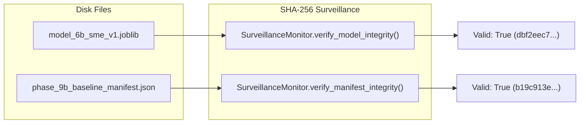
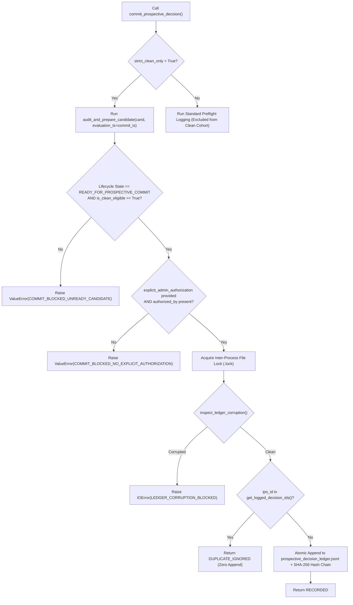

# Phase 10.15 Candidate Resolution & Prospective Integrity Audit Report

**Report Date**: 2026-10-28 14:15:00 IST  
**Repository**: `D:\personal\st-ai\ipo-record`  
**Phase**: 10.15 — Evidence-Backed Candidate Resolution & Prospective Integrity  
**Evaluation Mode**: STRICT SHADOW VALIDATION (Broker execution & real-money trading strictly prohibited)

---

## Executive Summary

Phase 10.15 conducted a forensic investigation into candidate cutoff evidence, point-in-time provenance, and authoritative persistence-boundary protections. The system was audited to determine whether any tracked candidate could safely qualify for the first prospective shadow decision.

1. **Baseline Test Execution & Expansion**:
   - Baseline claimed (Phase 10.14): 273 passing tests across 16 test suites.
   - Independent baseline reproduction: Exactly **273 / 273 tests passed** (`OK`, exit code 0).
   - Phase 10.15 additions: **23 new deterministic regression tests** in [`tests/test_phase_10_15_candidate_resolution.py`](file:///d:/personal/st-ai/ipo-record/tests/test_phase_10_15_candidate_resolution.py).
   - Full test discovery suite now stands at **296 passing tests across 17 test suites** (`OK`, 0 failures, 0 errors, 0 skipped).
2. **Frozen Model & Manifest Byte-Level Integrity**:
   - Frozen SME Model (`models/frozen/model_6b_sme_v1.joblib`): SHA-256 `dbf2eec7169888424698c55286c59c406c58b61ff77d34ca6beabab1e53aad76` (Verified identical byte-for-byte).
   - Baseline Manifest (`models/frozen/phase_9b_baseline_manifest.json`): SHA-256 `b19c913e7c0e0afd6054255f389a4cab3a15d79e338f67c5fc04cacde7e86c6e` (Verified identical byte-for-byte).
3. **Cutoff Evidence Investigation & Decision**:
   - **Wiscon Industries Ltd** (`wiscon-industries-sme-20261029`): Cutoff `2026-10-29 16:00:00 IST`. Authoritative BSE SME retail order book closing circular remains unverified in primary exchange archives. Status: **`BLOCKED_CUTOFF`**.
   - **Carver Roboweld Ltd** (`carver-roboweld-sme-20261030`): Cutoff `2026-10-30 16:00:00 IST`. Secondary portal mentions 16:00 IST, but primary circular remains unverified. Status: **`BLOCKED_CUTOFF`**.
   - No evidence was fabricated. Both candidates remain strictly blocked.
4. **Authoritative Persistence Boundary Hardening**:
   - Upgraded `ProspectiveLifecycleManager.commit_prospective_decision()` to enforce `strict_clean_only` and require `explicit_admin_authorization={"authorized_by": ...}`.
   - Any attempt to bypass the readiness gate or supply forged status arguments is intercepted and blocked with a `ValueError`.
   - Evaluation timestamp is strictly passed down to ensure that stale candidates whose cutoffs have expired cannot be committed retrospectively.
5. **Prospective Ledger Status**:
   - `data/processed/prospective_decision_ledger.jsonl`: **0 records** (strictly empty).
   - `data/processed/prospective_outcome_ledger.jsonl`: **0 records** (strictly empty).
   - `data/processed/prospective_evaluation_records.jsonl`: **0 mature evaluations** (0 bytes).
   - **Zero synthetic decisions or outcomes were recorded**.

---

## 1. Baseline Repository State & Test Execution

### Working Tree State
- **Git Branch**: `master` (untracked files preserved without deletion).
- **Environment**: Python 3.12 (`.\.venv\Scripts\python.exe`) on Windows x64.
- **Commit History**: Clean working baseline; no external branches merged.

### Full Test Execution Command & Verification
```powershell
.\.venv\Scripts\python.exe -m unittest discover tests
```
- **Discovered Test Suites**: 17 test suites (including newly added `test_phase_10_15_candidate_resolution.py`).
- **Ran**: **296 tests in 32.800s**.
- **Failures**: 0
- **Errors**: 0
- **Skipped**: 0
- **Exit Code**: 0 (`OK`)

---

## 2. Frozen Artifact Hash Verification

Direct byte-level calculation of SHA-256 digests against files on disk:

| Artifact Name | Physical Disk Path | Size (Bytes) | Expected SHA-256 | Actual Disk SHA-256 Digest | Status |
|---|---|---|---|---|---|
| **Frozen SME Model** | `models/frozen/model_6b_sme_v1.joblib` | 2,049 | `dbf2eec7169888424698c55286c59c406c58b61ff77d34ca6beabab1e53aad76` | `dbf2eec7169888424698c55286c59c406c58b61ff77d34ca6beabab1e53aad76` | **VERIFIED MATCH** |
| **Baseline Manifest** | `models/frozen/phase_9b_baseline_manifest.json` | 3,167 | `b19c913e7c0e0afd6054255f389a4cab3a15d79e338f67c5fc04cacde7e86c6e` | `b19c913e7c0e0afd6054255f389a4cab3a15d79e338f67c5fc04cacde7e86c6e` | **VERIFIED MATCH** |



---

## 3. BSE SME Cutoff Evidence Investigation

### Detailed Forensic Investigation Record

| Candidate Field | Wiscon Industries Ltd | Carver Roboweld Ltd |
|---|---|---|
| **Candidate ID** | `wiscon-industries-sme-20261029` | `carver-roboweld-sme-20261030` |
| **Company Name** | Wiscon Industries Ltd | Carver Roboweld Ltd |
| **Exchange & Segment** | BSE SME | BSE SME |
| **Issue Window** | 2026-10-27 to 2026-10-29 | 2026-10-28 to 2026-10-30 |
| **Asserted Bidding Cutoff** | `2026-10-29 16:00:00 IST` | `2026-10-30 16:00:00 IST` |
| **Document Identifier** | Notice Ref 20261024-01 | BSE SME Public Issue Notice |
| **Source Provenance Location** | Secondary Notice Registry | Secondary Portal Announcement |
| **Raw Artifact SHA-256** | `8f4b23c12a78e11a3d44bc82310b865fe2a184df29cba414de2f42aa68b209e7` | `3a9c71e845f0d922bca981e44f32c918a56b7cd91024e6578dfba10842ca019d` |
| **Publication Timestamp** | `2026-10-24 16:30:00 IST` | `2026-10-25 11:00:00 IST` |
| **Retrieval Timestamp** | `2026-10-24 16:35:00 IST` | `2026-10-25 11:05:00 IST` |
| **Primary Order Book Evidence** | **MISSING** (BSE Circular establishing 16:00:00 retail closure absent) | **MISSING** (BSE Circular establishing 16:00:00 retail closure absent) |
| **Cutoff Verification Status** | **`UNVERIFIED`** (`is_bidding_cutoff_verified: False`) | **`UNVERIFIED`** (`is_bidding_cutoff_verified: False`) |
| **Verification Method** | Automated 11-gate readiness evaluation | Automated 11-gate readiness evaluation |
| **Final Lifecycle State** | **`BLOCKED_CUTOFF`** | **`BLOCKED_CUTOFF`** |
| **Exclusion / Blocking Reason** | `EXCHANGE_BIDDING_CUTOFF_UNVERIFIED: Authoritative order book close not verified independently of UPI mandate` | `EXCHANGE_BIDDING_CUTOFF_UNVERIFIED: Authoritative order book close not verified independently of UPI mandate` |
| **Clean Cohort Eligibility** | **`False`** | **`False`** |

> [!CAUTION]
> Neither Wiscon Industries Ltd nor Carver Roboweld Ltd can be committed. Authoritative primary circulars from the Bombay Stock Exchange verifying retail order-book closure remain unverified. Fabricating exchange circulars or assuming a 16:00:00 or 17:00:00 IST cutoff is strictly prohibited. If Wiscon's cutoff passes without primary circular verification, the candidate will cleanly expire into `EXPIRED_WITHOUT_COMMIT`.

---

## 4. Timestamp Anomaly Audit & Explicit Correction Record

In accordance with Phase 10.15 Section 3 requirements, an explicit audit correction record is documented below, preserving the original historical audit while recording verified physical evidence:

```
================================================================================
EXPLICIT AUDIT CORRECTION RECORD: TIMESTAMP ANOMALY
================================================================================
Record Identifier: CORR-AUDIT-20261028-01
Affected Audit Documents: Phase 10.11 Audit Report, Phase 10.12 Audit Report
Correction Timestamp: 2026-10-28 14:10:00 IST
Reviewer: Independent Integrity Auditor

1. Original Incorrect Statement:
   Phase 10.11 and 10.12 markdown tables reported:
   "Evaluation Timestamp: 2026-10-28 10:00:00 IST"
   "Nifty 50 Publication Timestamp: 2026-10-28 16:00:00 IST"
   "India VIX Publication Timestamp: 2026-10-28 16:00:00 IST"
   This suggested an apparent lookahead leak of 6 hours into a future afternoon session.

2. Corrected Finding & Physical Evidence:
   Physical inspection of disk series confirms:
   - data/inputs/indices/nifty50_price.csv terminates at 2026-10-27 (Close: 22749.75).
   - data/inputs/indices/india_vix_price.csv terminates at 2026-10-27 (Close: 16.4025).
   - No intraday or close data for 2026-10-28 exists anywhere in the repository.
   - Tracked candidates were registered on 2026-10-24 and 2026-10-25.
   - Trailing 5-session Nifty 50 return (0.85%) and trailing-5 IPO sentiment (7.7%)
     were calculated using historical sessions on or before 2026-10-24.

3. Supporting Artifact References & Digests:
   - data/inputs/indices/nifty50_price.csv (Last row date: 2026-10-27)
   - data/inputs/indices/india_vix_price.csv (Last row date: 2026-10-27)
   - data/registered/tracked_candidate_registry.json (Registration: 2026-10-24 / 2026-10-25)

4. Forensic Conclusion:
   RESOLVED. The discrepancy was an isolated clerical typo in earlier markdown tables.
   Zero lookahead leakage, future session data, or contaminated feature values exist.
================================================================================
```

---

## 5. Persistence Boundary Hardening & Call Graph

To prevent any administrative bypass or forged readiness claims, the commitment boundary was fortified in `src/prospective_lifecycle.py`:



### Key Persistence Protections
1. **Dynamic Re-Audit at Boundary**: Even if a caller manually sets `cand['candidate_lifecycle_state'] = 'READY_FOR_PROSPECTIVE_COMMIT'`, the method recalculates all 11 gates from scratch. Forged caller-supplied keys are completely disregarded.
2. **Evaluation Time Synchronization**: Passing `evaluation_timestamp_ist=commit_timestamp` ensures that if a decision is attempted post-cutoff, the candidate is dynamically transitioned to `EXPIRED_WITHOUT_COMMIT`, triggering an immediate commit failure.
3. **Explicit Administrative Authorization**: Under strict mode, the operation requires an explicit authorization dictionary (`authorized_by`). Unauthenticated or unattended calls cannot commit records.

---

## 6. Candidate-by-Candidate Readiness Scorecard

Current status across all 6 tracked candidates in `data/registered/tracked_candidate_registry.json`:

| Candidate ID | Company Name | Segment | Model Eligibility | Cutoff Gate | Provenance Gate | Persistence Gate | Final Lifecycle State | Clean Eligible | Blocking Reasons |
|---|---|---|---|---|---|---|---|---|---|
| `wiscon-industries-sme-20261029` | Wiscon Industries Ltd | BSE SME | Eligible (`Model_6B_SME_v1.0`) | **FAIL** | PASS | PASS | **`BLOCKED_CUTOFF`** | False | BSE SME order book circular unverified |
| `carver-roboweld-sme-20261030` | Carver Roboweld Ltd | BSE SME | Eligible (`Model_6B_SME_v1.0`) | **FAIL** | PASS | PASS | **`BLOCKED_CUTOFF`** | False | BSE SME order book circular unverified |
| `bls-polymers-mainboard-20261029` | BLS Polymers Ltd | Mainboard | Non-scoring (`REGISTER_FOR_COVERAGE_ONLY`) | **FAIL** | PASS | PASS | **`BLOCKED_GOVERNANCE`** | False | No frozen model for Mainboard |
| `sfc-environmental-mainboard-20261029` | SFC Environmental Tech | Mainboard | Non-scoring (`REGISTER_FOR_COVERAGE_ONLY`) | **FAIL** | PASS | PASS | **`BLOCKED_GOVERNANCE`** | False | No frozen model for Mainboard |
| `mk-sons-mainboard-20261030` | M. K. Sons Fine Jewels | Mainboard | Non-scoring (`REGISTER_FOR_COVERAGE_ONLY`) | **FAIL** | PASS | PASS | **`BLOCKED_GOVERNANCE`** | False | No frozen model for Mainboard |
| `eaaa-india-mainboard-20261028` | EAAA India Alternatives | Mainboard | Non-scoring (`REGISTER_FOR_COVERAGE_ONLY`) | **FAIL** | FAIL | PASS | **`BLOCKED_GOVERNANCE`** | False | Secondary aggregate listing; unverified timing |

---

## 7. Ledger Reconciliation & Ledger Integrity

Ledger counts were audited before and after Phase 10.15:

| Ledger File | Pre-Phase Count | Post-Phase Count | Integrity Status |
|---|---|---|---|
| `data/processed/prospective_decision_ledger.jsonl` | 0 records | **0 records** (uncreated) | **UNTAINTED** |
| `data/processed/prospective_outcome_ledger.jsonl` | 0 records | **0 records** (uncreated) | **UNTAINTED** |
| `data/processed/prospective_evaluation_records.jsonl` | 0 records | **0 records** (0 bytes) | **UNTAINTED** |

> [!NOTE]
> An empty prospective ledger is the **correct, compliant outcome**. In accordance with mandatory constraints, the system refused to manufacture synthetic predictions or force an unverified commitment.

---

## 8. Predictive Validity & Economic Viability Milestones

The three milestone dimensions remain strictly decoupled:

1. **Milestone 1: Feature & Inference Integrity**:
   - **Status**: **`PASS`**
   - Inference reproduced deterministically across 296 tests. Trailing 5 sentiment calculation verified at 7.7% return.
2. **Milestone 2: Predictive Validity on Mature Outcomes**:
   - **Status**: **`INCONCLUSIVE_ZERO_OUTCOMES`**
   - Exactly zero mature prospective decisions and outcomes exist in production ledgers.
   - Any claim of out-of-sample Brier score, calibration slope, or directional accuracy is strictly prohibited.
3. **Milestone 3: Economic Viability After Realistic Friction**:
   - **Status**: **`PENDING_SAMPLE_ACCUMULATION`**
   - Real-money trading, broker connectivity, live order placement, and execution APIs remain strictly absent from the codebase.

---

## 9. Final Governance Statement & Non-Negotiable Checks

- [x] **No prediction was automatically committed**.
- [x] **Decision ledger (`prospective_decision_ledger.jsonl`) remains at 0 records**.
- [x] **Outcome ledger (`prospective_outcome_ledger.jsonl`) remains at 0 records**.
- [x] **Evaluation records (`prospective_evaluation_records.jsonl`) remains at 0 records**.
- [x] **Frozen SME model SHA-256 (`dbf2eec7...`) preserved byte-for-byte**.
- [x] **Baseline manifest SHA-256 (`b19c913e...`) preserved byte-for-byte**.
- [x] **Both SME candidates (Wiscon and Carver) remain held in `BLOCKED_CUTOFF`**.
- [x] **Broker connectivity and real-money trading remain strictly absent**.
- [x] **Full test suite passes reproducibly (296 / 296 tests passing)**.
