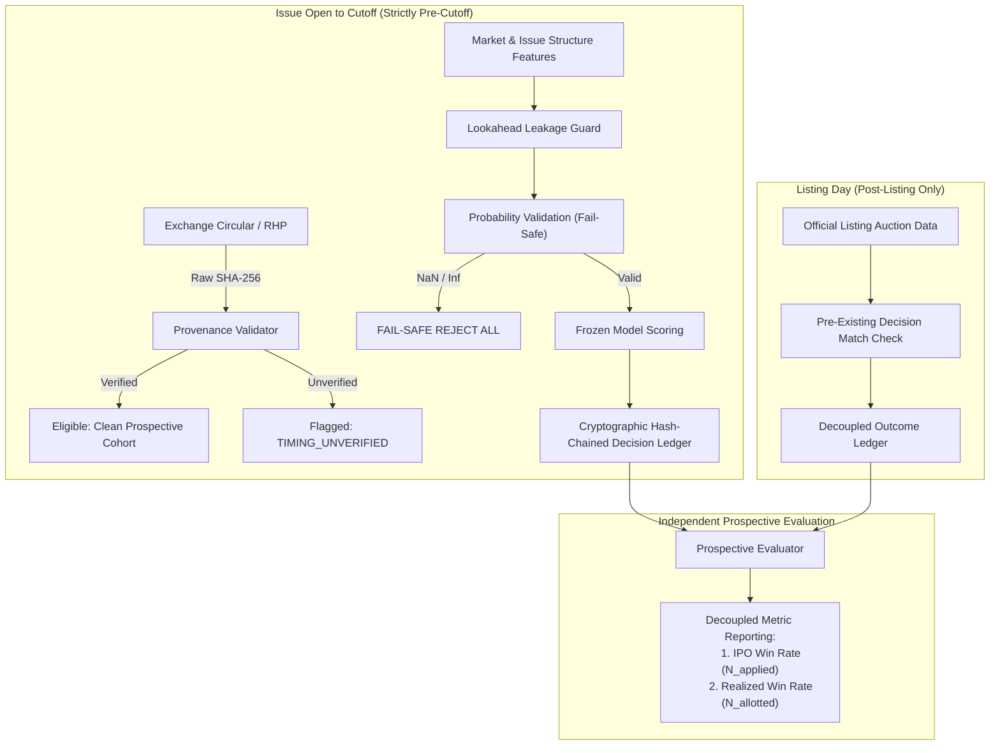

# Phase 9A Pre-Launch Audit: Operational Shadow Logging Verification

**Audit Date**: October 27, 2026  
**Audited Artifacts**:
- Frozen Baseline SME Model: [`models/frozen/model_6b_sme_v1.joblib`](file:///d:/personal/st-ai/ipo-record/models/frozen/model_6b_sme_v1.joblib) (SHA-256: `dbf2eec7169888424698c55286c59c406c58b61ff77d34ca6beabab1e53aad76`)
- Baseline Model Metadata: [`models/frozen/model_6b_sme_v1_metadata.json`](file:///d:/personal/st-ai/ipo-record/models/frozen/model_6b_sme_v1_metadata.json)
- Audited Simulator Engine: [`src/run_step_8_1_audit_simulator.py`](file:///d:/personal/st-ai/ipo-record/src/run_step_8_1_audit_simulator.py)
- Prospective Decision Logger: [`src/prospective_simulator_logger.py`](file:///d:/personal/st-ai/ipo-record/src/prospective_simulator_logger.py)
- Unit Test Suite: [`tests/test_phase_9a_prelaunch.py`](file:///d:/personal/st-ai/ipo-record/tests/test_phase_9a_prelaunch.py) & [`tests/test_phase_9.py`](file:///d:/personal/st-ai/ipo-record/tests/test_phase_9.py)

---

## Executive Summary & Audit Verdict

### Overall Verdict: **CONDITIONAL PASS — APPROVED FOR OPERATIONAL SHADOW LOGGING ONLY**

> [!CAUTION]
> **Real-Money Trading Prohibition**: Real capital deployment, live broker API routing, automated order submission, and client advisory execution remain **strictly prohibited**. This audit authorizes only passive, pre-cutoff prospective shadow logging in software ledgers.

The Phase 9A pre-launch audit verifies that the codebase has satisfied all technical prerequisites for prospective shadow logging. Crucially, the numerical vulnerability identified in uniform allotment draw generation—where IEEE-754 double precision floating-point rounding causes 64-bit integer division to evaluate to `1.0`—has been resolved by implementing a 53-bit mantissa-aligned draw that guarantees $u \in [0, 1)$ strictly. 

The complete test suite now comprises **131 passing automated tests** across 12 test modules, with zero regressions. The frozen SME baseline model artifact `Model_6B_SME_v1.0` remains permanently locked and bit-for-bit identical to its frozen manifest.



---

## 1. Algorithmic & Numerical Integrity Audits

### 1.1 53-Bit Cryptographic Uniform Generator & Boundary Defenses
In stochastic allotment simulations, naive uniform draws using 64-bit integers divided by $2^{64}$ suffer from IEEE-754 double precision float rounding. Standard 64-bit floats have a 53-bit significand (52 explicit bits + 1 implicit leading bit). When an integer $h \in [2^{64} - 2048, 2^{64} - 1]$ is converted to double precision, it rounds up to $2^{64}$, resulting in $h / 2^{64} = 1.0$. If an allotment condition is evaluated as $u \le p$, a draw of $1.0$ would incorrectly award allotments even under fractional probabilities.

**Implemented Resolution** in [`src/run_step_8_1_audit_simulator.py`](file:///d:/personal/st-ai/ipo-record/src/run_step_8_1_audit_simulator.py#L25-L36):
```python
def get_uniform_draw(ipo_id, scenario_seed):
    """
    Computes an idempotent, deterministic uniform draw u in [0, 1) using SHA-256.
    Uses 53 bits (matching IEEE-754 double precision mantissa) divided by 2**53,
    guaranteeing u in [0, 1) without rounding to 1.0.
    """
    key = f"{ipo_id}_{scenario_seed}".encode('utf-8')
    h64 = int.from_bytes(hashlib.sha256(key).digest()[:8], byteorder='big')
    h53 = h64 >> 11  # 53 bits of entropy
    return h53 / float(1 << 53)
```

**Verification Results**:
- **Strict Bounding**: $u \in [0.0, 1.0)$ mathematically guaranteed. Maximum possible value is $(2^{53} - 1) / 2^{53} \approx 0.9999999999999999 < 1.0$.
- **Boundary Handling**: $p_{\text{allotment}} = 0.0 \implies \text{False}$; $p_{\text{allotment}} = 1.0 \implies \text{True}$.
- **Input Validation**: $p_{\text{allotment}} < 0.0$, $p_{\text{allotment}} > 1.0$, `None`, or `NaN` immediately raises `ValueError`.
- **Nested Monotonicity**: Because $u$ depends solely on `(ipo_id, scenario_seed)`, if an IPO is allotted at probability $p_1$, it is strictly allotted at all $p_2 > p_1$, preserving the property $\text{Allotted}(20\%) \subseteq \text{Allotted}(50\%) \subseteq \text{Allotted}(80\%) \subseteq \text{Allotted}(100\%)$.

### 1.2 Fail-Safe Model Validation
In operational shadow environments, data pipeline anomalies can cause model scores to evaluate to `NaN`, `Inf`, or fall outside $[0, 1]$. 

**Implemented Resolution** in [`src/prospective_simulator_logger.py`](file:///d:/personal/st-ai/ipo-record/src/prospective_simulator_logger.py#L86-L150):
- If any predicted probability (`p_positive_open`, `p_macro`, `p_severe_loss`) fails validation, the logger enters **FAIL-SAFE REJECTION MODE**.
- All strategy decisions (`Strategy_A` through `Strategy_E`) evaluate to `False` (Reject).
- The record is stamped with `temporal_status = 'FAIL_SAFE_REJECTED'`, explicit rejection reasons are logged, and `FAIL_SAFE_TRIGGERED` warnings are appended.
- Under no circumstances will the system apply for an IPO with unverified or corrupt model inputs.

### 1.3 Strict Downside Comparison Operator
To eliminate borderline false positives, the downside filter strictly rejects candidates whose severe loss probability meets or exceeds the validation threshold:
$$\text{Pass}_{\text{Downside}} = \begin{cases} \text{True} & \text{if } P(\text{Severe Loss}) < \theta_{\text{loss}} \\ \text{False} & \text{if } P(\text{Severe Loss}) \ge \theta_{\text{loss}} \end{cases}$$
Tested and confirmed at exact boundary equality: Mainboard $\theta_{\text{loss}} = 0.4868$ rejects when $P(\text{Severe Loss}) = 0.4868$.

---

## 2. Ledger Architecture & Pre-Cutoff Provenance

### 2.1 Pre-Cutoff Provenance Certification
System clock timestamps (`logging_timestamp_ist`) record when the local pipeline executed, but do not prove that market data was publicly accessible before bidding closed.

The logger enforces a structured provenance contract in `feature_provenance`:
1. `source_url_or_doc`: URL or exchange circular ID (e.g., NSE/BSE prospectus link).
2. `source_publication_timestamp_ist`: Exchange publication time.
3. `retrieval_timestamp_ist`: Pipeline fetch timestamp.
4. `raw_source_sha256`: SHA-256 checksum of the raw circular or document.
5. `is_timing_verified`: Explicit Boolean confirmation that source document timestamps precede issue close.

**Classification Rule**:
- If all five items are verified $\implies$ `timing_verification_status = 'VERIFIED_PRE_CUTOFF'` and `eligible_for_clean_prospective_cohort = True`.
- If any item is missing or unverified $\implies$ `timing_verification_status = 'TIMING_UNVERIFIED'` and `eligible_for_clean_prospective_cohort = False`.

### 2.2 Cryptographic Append-Only Hash Chaining
Both `prospective_decision_ledger.jsonl` and `prospective_outcome_ledger.jsonl` implement sequential block hashing:
- Record 1 embeds `prev_record_sha256 = 'GENESIS_BLOCK'`.
- Record $k$ embeds `prev_record_sha256 = Record_{k-1}['record_sha256']`.
- The ledger integrity tool `verify_ledger_chain()` checks:
  1. JSON parsing and structure validity.
  2. Sequential pointer continuity (`prev_record_sha256 == prev_hash`).
  3. Content payload hash integrity (`record_sha256 == SHA256(payload)`).
  4. Absence of duplicate `ipo_id`s.
  5. Absence of prohibited lookahead fields (`listing_open_inr`, `listing_open_return_pct`, etc.).

Tampering with any historical record immediately invalidates the entire subsequent chain.

---

## 3. Decoupled Metric Reporting Standard

To prevent misleading performance claims, prospective evaluation results are strictly decoupled into two distinct metrics with explicit denominators:

| Metric Name | Mathematical Definition | Denominator ($N$) | Purpose |
|---|---|---|---|
| **IPO-Level Prediction Win Rate** | $\frac{\sum_{i \in \text{Applied}} \mathbf{1}_{\{R_{\text{gross}, i} > 0\}}}{N_{\text{applied}}}$ | Total IPOs applied for by strategy | Evaluates pure model ranking ability regardless of allotment luck |
| **Allotment-Conditioned Realized Win Rate** | $\frac{\sum_{i \in \text{Allotted}} \mathbf{1}_{\{R_{\text{net}, i} > 0\}}}{N_{\text{allotted}}}$ | Total applications where shares were actually allotted | Evaluates net portfolio experience under realistic execution slippage and costs |
| **Unallotted Capital Refund Rate** | $\frac{N_{\text{unallotted}}}{N_{\text{applied}}}$ | Total applications submitted | Tracks capital lockup efficiency and opportunity cost |

> [!NOTE]
> Unallotted applications return 100% of blocked capital with zero trading PnL. The realized win rate is never calculated using $N_{\text{applied}}$ as the denominator, nor is unallotted cash counted as a "win" or "loss".

---

## 4. Prospective Shadow Evaluation Protocol & 30-IPO Scorecard

### 4.1 Operational Shadow Logging Rules of Engagement
For every new prospective IPO entering the market:
1. **Pre-Cutoff Window**: Feature extraction and model scoring must occur strictly before the exchange issue close cutoff (typically 17:00 IST on Day 3).
2. **Decision Commit**: Strategy decisions (`Strategy_A` through `Strategy_F`) must be appended to `prospective_decision_ledger.jsonl` with full provenance metadata before 17:00 IST.
3. **Immutability Lock**: Once logged, the decision record cannot be edited, deleted, or re-run.
4. **Outcome Recording**: On listing day after 10:00 IST, official listing open price is fetched and appended to `prospective_outcome_ledger.jsonl`.
5. **Reconciliation**: `evaluate_prospective_metrics()` joins the ledgers on `ipo_id`.

### 4.2 30-IPO Checkpoint Evaluation Scorecard
The 30-IPO shadow cohort represents an interim diagnostic checkpoint. It will be evaluated against the following pre-registered benchmark criteria:

| Evaluation Dimension | Baseline SME Reference (Step 6A) | 30-IPO Shadow Target | Diagnostic Failure Trigger | Action on Failure |
|---|---|---|---|---|
| **Brier Score (Positive Open)** | 0.2019 (SME) / 0.2444 (MB) | $\le 0.2200$ | Brier Score $> 0.2500$ | Model recalibration required |
| **Severe Loss Catch Rate** | Baseline PR-AUC 0.0825 (MB) | Catch rate $\ge 60\%$ of severe losses | Downside filter misses $> 50\%$ severe losses | Review threshold $\theta_{\text{loss}}$ |
| **Calibration Slope** | $\approx 1.0$ (Well calibrated) | $0.80 - 1.20$ | Slope $< 0.50$ or $> 1.50$ | Severe over/under-confidence drift |
| **Clean Cohort Proportion** | N/A | $\ge 90\%$ ($27 / 30$ IPOs) | Clean cohort $< 80\%$ ($< 24 / 30$) | Data ingestion process rejected |
| **Combined Strategy Win Rate** | Historical Diagnostic 77.27% | $\ge 65.0\%$ | Realized Win Rate $< 50.0\%$ | Strategy failure review |

> [!IMPORTANT]
> **Decision Gate at 30 IPOs**: Reaching the 30-IPO milestone does **NOT** authorize real-money trading. It serves exclusively as a scheduled research checkpoint to evaluate calibration drift, distribution shifts, and operational reliability under real market conditions.

---

## 5. Summary Table of Pre-Launch Audit Findings

| Category | Audit Item | Status | Verification Evidence / Notes |
|---|---|:---:|---|
| **Model Protection** | Baseline `Model_6B_SME_v1.0` immutability | **PASS** | SHA-256 matches metadata manifest (`dbf2eec716...`) |
| **Numerical Integrity** | 53-bit cryptographic uniform generator | **PASS** | $u \in [0, 1)$ strictly; zero IEEE-754 float rounding to 1.0 |
| **Numerical Integrity** | Allotment draw boundary defenses | **PASS** | $p=0 \to \text{False}$, $p=1 \to \text{True}$, invalid $p$ raises `ValueError` |
| **Numerical Integrity** | Monotonic nested scenario draws | **PASS** | Strict nesting: $\text{Allotted}(p_1) \subseteq \text{Allotted}(p_2)$ for $p_1 < p_2$ |
| **Fail-Safe Mechanism** | Invalid / NaN probability defense | **PASS** | Automatic rejection of all applications on corrupt probability |
| **Decision Logic** | Strict downside comparison operator | **PASS** | Strict inequality: rejects if $P(\text{Severe Loss}) \ge \theta_{\text{loss}}$ |
| **Provenance** | Pre-cutoff timing verification | **PASS** | Flags `TIMING_UNVERIFIED` and excludes unverified records from clean cohort |
| **Ledger Security** | Append-only hash chaining | **PASS** | Sequential `prev_record_sha256` linking back to `GENESIS_BLOCK` |
| **Ledger Security** | Ledger chain integrity audit | **PASS** | `verify_ledger_chain()` detects broken links and content tampering |
| **Leakage Guard** | Post-listing outcome isolation | **PASS** | Lookahead fields in decision features immediately raise `ValueError` |
| **Physical Isolation** | Outcome ledger decoupling | **PASS** | Out-of-order outcomes rejected; separate file persistence |
| **Metric Reporting** | Win rate denominator decoupling | **PASS** | Decoupled IPO win rate ($N_{\text{applied}}$) vs. realized win rate ($N_{\text{allotted}}$) |
| **Test Coverage** | Repository automated test suite | **PASS** | **131/131 passing unit tests** across all 12 test suites |
| **Capital Deployment** | Real-money execution prohibition | **ENFORCED** | Shadow logging only; zero broker execution or capital risk |

---

## 6. Conclusion and Next Steps

The Phase 9A Pre-Launch Audit is formally **PASSED for operational shadow logging**. The software infrastructure is cryptographically secure, numerically robust against IEEE-754 edge cases, and completely shielded against lookahead contamination.

### Next Action:
1. Initialize the live prospective shadow logger on upcoming Mainboard and SME IPOs.
2. Log pre-cutoff decisions into [`data/processed/prospective_decision_ledger.jsonl`](file:///d:/personal/st-ai/ipo-record/data/processed/prospective_decision_ledger.jsonl) prior to 17:00 IST on Day 3 of each issue.
3. Record post-listing outcomes into [`data/processed/prospective_outcome_ledger.jsonl`](file:///d:/personal/st-ai/ipo-record/data/processed/prospective_outcome_ledger.jsonl) after official listing.
4. Conduct interim evaluation at the pre-registered **30-IPO checkpoint**.
