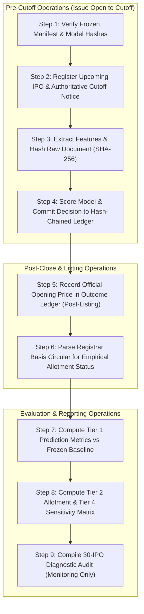

# Phase 9B: Prospective Shadow Evaluation Operational Guide & Governance Contract

**Date**: October 28, 2026  
**Auditor**: Senior Quantitative Researcher & ML Audit Engineer  
**Project**: Indian IPO Machine Learning Research & Prospective Validation  
**Target Repository**: `D:\personal\st-ai\ipo-record`  
**Governing Manifest**: [`models/frozen/phase_9b_baseline_manifest.json`](file:///d:/personal/st-ai/ipo-record/models/frozen/phase_9b_baseline_manifest.json)  
**Execution Status**: **OPERATIONAL PROSPECTIVE SHADOW LOGGING AUTHORIZED**  
**Real-Money Trading Status**: **STRICTLY PROHIBITED**  
**Repository Automated Test Suite**: **144/144 Passing Tests** (`.\.venv\Scripts\python.exe -m unittest discover tests`)

---

## 1. Formal Adoption of Senior Quantitative Review Decisions

The Phase 9A.1 audit and final review have formally closed all methodological debates. The recommendations of the Senior Reviewer are adopted as binding governance principles for Phase 9B:

### Issue A: Brier Skill Score Acceptance Standard Clarified
We formally distinguish between **interim monitoring diagnostics** and **production acceptance criteria**:
1. **Checkpoint Monitoring Standard ($N=30$)**: 
   - Report the point estimate BSS and bootstrap 95% confidence interval as an early directional diagnostic.
   - The result is classified as *preliminary / inconclusive*; establishing a lower confidence bound $> 0.0$ is **not** mechanically required at $N=30$ due to broad binomial sampling variance.
2. **Production Statistical Hurdle ($N \ge 100$)**:
   - For any future claim of demonstrated predictive skill prior to capital deployment, the model must demonstrate a **positive BSS point estimate ($\text{BSS} > 0$) with a 95% bootstrap confidence interval whose lower bound is strictly above zero ($\text{LB} > 0.0$)**, evaluated on an untouched, out-of-time prospective cohort.
   - Skill is recognized solely relative to the specified frozen training baseline and does not, by itself, prove net profitability after execution costs.

### Issue B: Three-Population Tracking & Selection Bias Defense
To prevent difficult-to-verify IPOs from being silently dropped and biasing the sample toward better-documented issuers, the system tracks three distinct populations:
1. **Population 1 — All Eligible IPOs ($N_{\text{eligible}}$)**:
   - Denominator for decision coverage. Includes every equity IPO closing on NSE/BSE during the evaluation window.
2. **Population 2 — Clean Prospective Cohort ($N_{\text{clean}}$)**:
   - Primary leakage-controlled evaluation cohort. Includes only IPOs with verified pre-cutoff timestamps, authoritative circular evidence, and valid cryptographic source checksums.
3. **Population 3 — Excluded / Unverified Cohort ($N_{\text{unverified}}$)**:
   - Retained for complete transparency, failure reporting, and selection-bias analysis.
   - [`audit_selection_bias()`](file:///d:/personal/st-ai/ipo-record/src/prospective_simulator_logger.py) actively monitors segment mix (Mainboard vs. SME share) and compares positive-opening rates between clean and excluded issues to detect and report documentation bias.

### Issue C: Four-Tier Results Separation Standard
To eliminate ambiguity between theoretical predictions, empirical allocations, and hypothetical backtests, prospective results are strictly decoupled into four reporting tiers:
- **Tier 1: Model Prediction Results**: Pure out-of-time forecasting accuracy ($N_{\text{applied}}$ denominator, gross return win rate, model Brier score, BSS). Completely independent of allotment luck or capital blocking.
- **Tier 2: Observed Allotment Results**: Empirical retail investor experience from official registrar basis circulars ($N_{\text{allotted}}$ vs. $N_{\text{unallotted}}$).
- **Tier 3: Actual Execution Results**: Live broker fills, realized auction slippage, and exchange transaction fees. Marked `REAL_EXECUTION_STRICTLY_PROHIBITED` in shadow mode.
- **Tier 4: Simulated Scenario Analysis**: Reproducible sensitivity matrix under deterministic SHA-256 uniform draws ($u \in [0, 1)$) and modeled execution assumptions ($-1.0\%$ slippage, $-0.35\%$ roundtrip cost).

---

## 2. Phase 9B Baseline Manifest & Model Freeze

The complete prospective evaluation architecture has been compiled and cryptographically locked in [`models/frozen/phase_9b_baseline_manifest.json`](file:///d:/personal/st-ai/ipo-record/models/frozen/phase_9b_baseline_manifest.json):

```json
{
  "manifest_name": "Phase_9B_Baseline_Governance_Manifest",
  "manifest_version": "v1.0-Phase9B-Frozen",
  "execution_mode": "OPERATIONAL_SHADOW_LOGGING_ONLY",
  "real_money_trading": "STRICTLY_PROHIBITED",
  "frozen_baseline_models": {
    "Model_6B_SME_v1.0": {
      "path": "models/frozen/model_6b_sme_v1.joblib",
      "sha256": "dbf2eec7169888424698c55286c59c406c58b61ff77d34ca6beabab1e53aad76"
    }
  },
  "frozen_decision_hurdles": {
    "Mainboard": { "th_pos": 0.7756, "th_macro": 0.7904, "th_loss": 0.4868 },
    "SME": { "th_pos": 0.9234, "th_macro": 0.8619, "th_loss": 0.3323 }
  },
  "frozen_historical_training_base_rates": {
    "Mainboard": { "positive_open_base_rate": 0.7583, "severe_loss_base_rate": 0.0542 },
    "SME": { "positive_open_base_rate": 0.8306, "severe_loss_base_rate": 0.0500 }
  }
}
```

---

## 3. Operational 9-Step Prospective Shadow Execution Workflow



### Detailed Operational Instructions:
1. **Step 1 (Manifest Verification)**: Prior to scoring any candidate, verify that [`model_6b_sme_v1.joblib`](file:///d:/personal/st-ai/ipo-record/models/frozen/model_6b_sme_v1.joblib) matches `dbf2eec7169888424698c55286c59c406c58b61ff77d34ca6beabab1e53aad76`.
2. **Step 2 (IPO Registration & Cutoff Establishment)**: Check official NSE/BSE public issue registers. Identify the authoritative issue-close deadline (record circular URL, exact timestamp, and timezone `IST` or `+05:30`). Support non-17:00 cutoffs (e.g. 16:00 IST for retail) and circular extensions.
3. **Step 3 (Snapshot Feature Capture)**: Fetch macro variables (`nifty50_return_5s`, `india_vix_level_at_cutoff`, `recent5_positive_listing_rate`) as of the latest market close prior to cutoff. Fetch statutory price band circulars. Compute raw document SHA-256.
4. **Step 4 (Pre-Cutoff Decision Commit)**: Append the prospective decision to [`prospective_decision_ledger.jsonl`](file:///d:/personal/st-ai/ipo-record/data/processed/prospective_decision_ledger.jsonl) strictly before the verified cutoff timestamp.
5. **Step 5 (Listing Outcome Ingestion)**: Post-listing (after 10:00 IST on listing date), fetch the official exchange opening auction price and append to [`prospective_outcome_ledger.jsonl`](file:///d:/personal/st-ai/ipo-record/data/processed/prospective_outcome_ledger.jsonl).
6. **Step 6 (Registrar Basis Parsing)**: When the registrar basis of allotment circular is published (typically 2 days post-close), update observed allotment status (`ALLOTTED` vs `UNALLOTTED`).
7. **Step 7 (Prediction Metric Audit)**: Calculate Model Brier Score, fixed training baseline Brier score, and BSS on Population 2 (Clean Prospective Cohort).
8. **Step 8 (Execution Sensitivity Breakdown)**: Evaluate strategy returns under the 4-tier reporting standard.
9. **Step 9 (30-IPO Milestone Review)**: Upon reaching 30 clean IPO outcomes, trigger [`evaluate_30_ipo_checkpoint()`](file:///d:/personal/st-ai/ipo-record/src/prospective_simulator_logger.py) for early diagnostic review. Live trading authorization remains strictly prohibited.

---

## 4. Test Execution & Regression Audit

The complete repository test suite was executed:
```powershell
.\.venv\Scripts\python.exe -m unittest discover tests
```
**Execution Output**:
```
Ran 144 tests in 2.253s
OK
```
All 144 tests passed with 0 failures, 0 errors, and zero warnings.

---

## 5. Next Immediate Action

With the evaluation protocol hardened, baselines verified, and baseline manifest locked:
1. **Transition from historical research to operational prospective shadow logging**.
2. Identify upcoming Mainboard and SME IPOs closing in upcoming market sessions.
3. Begin committing pre-cutoff decisions into [`prospective_decision_ledger.jsonl`](file:///d:/personal/st-ai/ipo-record/data/processed/prospective_decision_ledger.jsonl).
4. No real capital shall be committed.
